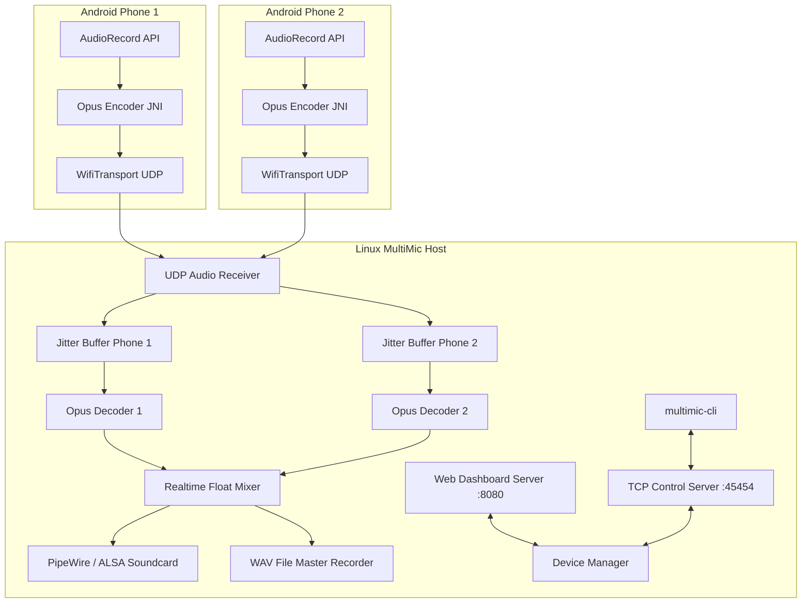

# BlueFare Architecture Documentation

## System Architecture

## Component Breakdown

1. **Android MultiMic Client**:
   - `AudioRecord`: Captures 48000 Hz, mono 16-bit PCM audio.
   - `Foreground Service`: Runs active recording session with persistent notification.
   - `Opus Encoder`: Converts 20ms PCM frames to Opus compressed frames (32 kbps default).
   - `NetworkClient`: UDP packetizer and TCP PIN pairing client.

2. **Linux Server (`multimic-server`)**:
   - `TcpServer`: Handles device discovery, authentication, session tokens, and CLI control commands.
   - `DiscoveryBeacon`: Broadcasts server availability on LAN via UDP port 45456.
   - `AudioReceiver`: High-performance UDP socket loop validating sessions and routing incoming frames to per-device buffers.
   - `AudioJitterBuffer`: 40-80ms reordering buffer with missing packet detection and Opus PLC (Packet Loss Concealment).
   - `AudioMixer`: Multi-channel float mixing engine with per-device gain, mute, volume ramping, dynamic headroom limiter, clipping prevention, and peak/RMS level meters.
   - `AudioOutput`: Direct output to PipeWire / ALSA audio subsystems and master WAV file recorder (`--record session.wav`).
   - `WebServer`: Built-in HTTP dashboard at `http://127.0.0.1:8080` displaying connected devices, real-time volume controls, mute buttons, and level meters.
